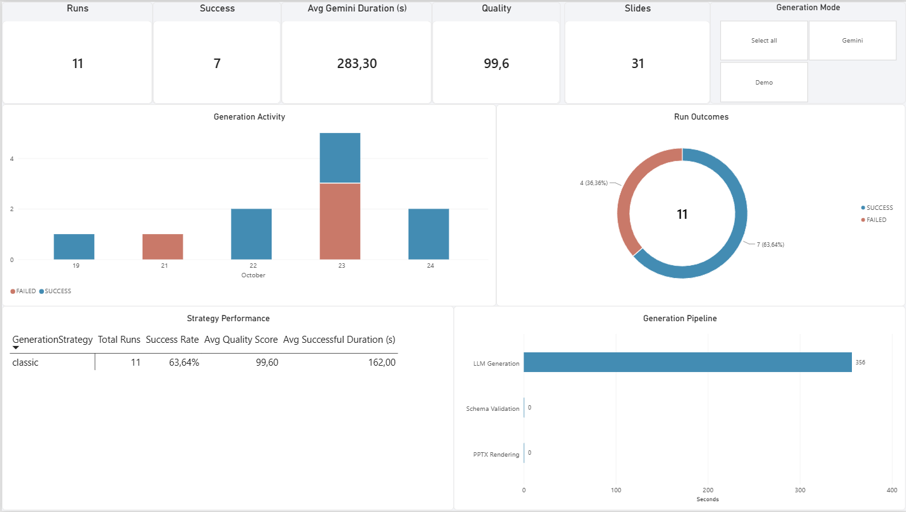
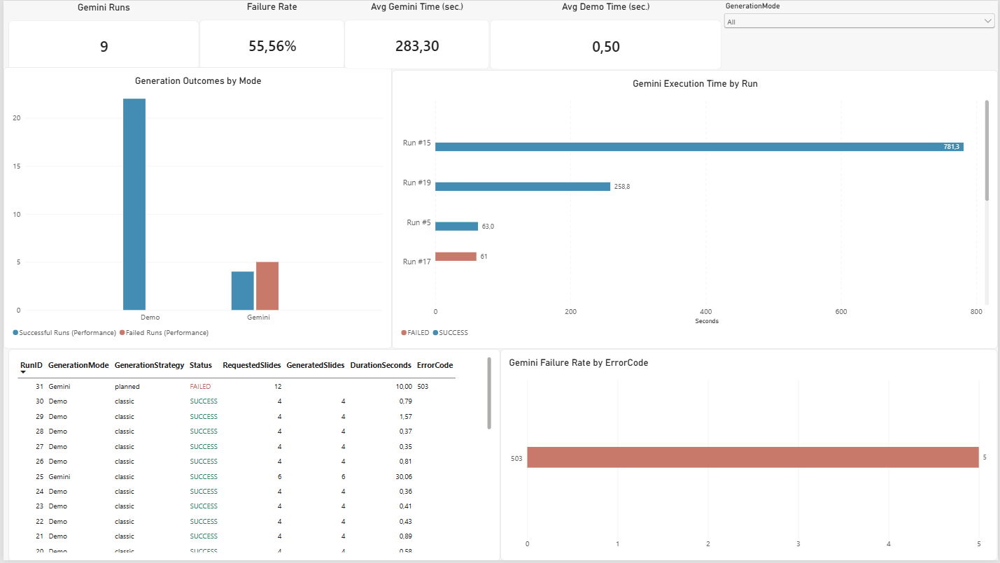

# SlideForge AI

**AI-powered presentation generation · Recoverable workflows · SQL & Power BI analytics**

SlideForge AI is a Python/Streamlit application that turns a topic or a structured outline into an **editable PowerPoint presentation**. It combines Gemini-based content generation, Pydantic validation, reusable PowerPoint layouts, a heuristic Quality Engine, and an optional SQL Server / Power BI analytics layer.

The project's central challenge is not simply asking an LLM to write slides. It is building a **repeatable, measurable process that can validate structured output, recover from failures, and avoid repeating completed work**.

> **Project status — v1.1 portfolio release**  
> **v1.0:** Classic/Demo presentation generation (tagged `v1.0.0`).  
> **v1.1:** Planned Generation, resumable batches, bounded API retries, validation-aware Content Repair, and batch-level SQL telemetry. Available on `main`
and tagged as `v1.1.0`.
> **Verified:** One complete **12-content-slide** Planned run using the live Gemini API, including successful reuse of checkpoints from an earlier failed run. **79 automated tests passed locally** on November 3, 2026.  
> **Scope:** This is a portfolio prototype, not a production-grade or legally authoritative presentation service. Longer 20–25-slide end-to-end runs and live Content Repair behavior require further validation.

## At a Glance: Business Problem → Solution → Evidence

| Business / operational challenge | SlideForge approach | Evidence |
|---|---|---|
| LLM responses may violate required document structures | Layout-specific Pydantic contracts and validation before rendering | Invalid fields are rejected; repair logic has offline tests |
| A failed API request can waste previously generated content | Persist validated batches as local checkpoints; resume only missing work | Two batches reused after a failed live run |
| AI latency and error rates are hard to diagnose | Capture run/batch status, duration, API calls, checkpoint hits, and token metadata when available | SQL Server views and Power BI reporting |
| Automatically drafted slides can be inconsistent | Deterministic rendering with `python-pptx` and layout-aware quality checks | Editable PPTX output and Quality Engine results |

**Why this matters for business analysis:** the project brings together process decomposition, data contracts, exception handling, measurable KPIs, and reporting—not just prompt engineering. The same principles are relevant to document workflows, process automation, and operational monitoring.

## Verified Live Test: Checkpoint Recovery

A 12-slide presentation on **legal and administrative compliance supported by Business Intelligence** was divided into **four batches of three slides**. An earlier run completed the first two batches before failing at the third. A later run reused those two checkpoints and successfully generated the remaining slides.

| Metric | Failed run **55** | Successful run **57** |
|---|---:|---:|
| Final status | `FAILED` | **`SUCCESS`** |
| Requested / generated content slides | 12 / incomplete | **12 / 12** |
| Batch size | 3 | 3 |
| Newly generated batches | 2 | 2 |
| Reused checkpoint batches | 0 | **2** |
| Failed batch records | 1 | **0** |
| Gemini API calls in that run | 3 | **2** |
| Checkpoint fingerprint | `dde807b53746…` | `dde807b53746…` |

**Observed outcome:** run 57 completed four batches while calling Gemini only for the two missing batches. The successful result contained **12 content slides plus a title slide**. This demonstrates recovery of completed work under the same plan and configuration; it does **not** establish a general API success rate or statistically proven cost savings.

The generated presentation was reviewed through a 13-page PDF export. As with any generated document, its factual and legal assertions require editorial review; structural validation and the Quality Engine are not fact-checking systems.

## Power BI Analytics

SQL telemetry is transformed into a report for understanding generation volume, errors, timings, content structure, quality warnings, and recovery behavior. **Demo** and **Gemini** runs are kept distinct, and synthetic test rows can be excluded using `IsTest`.

### Operational overview



### Generation performance



Additional report views:

- [Slide Analysis — layout usage and content density](screenshots/slide_analysis.png)
- [AI Reliability — batch outcomes, API calls and checkpoint reuse](screenshots/ai_reliability.png)

The wider report also covers errors and quality findings. Screenshots are included in the repository; the Power BI report itself is maintained as a separate local artifact. **Sample sizes are small and may include historical or synthetic tests**, so these dashboards illustrate observability rather than production reliability benchmarks.

## Features and Validation Status

| Capability | Description | Validation |
|---|---|---|
| **Classic Generation** | Generate content from a topic with Gemini; separate offline Demo Mode | Existing v1.0 workflow |
| **11 editable layouts** | Consistent PowerPoint objects rendered through `python-pptx` | Automated layout/rendering tests |
| **Presentation Planner** | Create a structured outline with sections, slide objectives, and selected layouts | Available through Python helper; not integrated into the Planned UI |
| **Planned Generation** | Generate an existing outline in smaller batches and assemble a complete presentation | **Live 12-slide completion verified** |
| **Resumable checkpoints** | Validate, hash, atomically save and reuse completed batches | **Live cross-run recovery verified** |
| **API retry** | Up to three total attempts for transient HTTP `429` / `503`, with exponential backoff and jitter | Automated tests and observed live errors |
| **Content Repair** | One targeted extra request for schema-invalid JSON followed by revalidation | **Offline tests passed; live repair not independently confirmed** |
| **Quality Engine v2** | Layout-aware heuristic scores and `INFO` / `WARNING` / `ERROR` findings | Automated tests; not a factual correctness assessment |
| **SQL telemetry** | Per-run and per-batch logging with optional token metadata | SQL integration and observed live-run records |
| **Power BI reporting** | Operational, performance, slide, quality and reliability analysis | Local report with repository screenshots |

The schema supports **1–25 content slides**, in addition to the title slide. The upper limit describes accepted input, **not** a validated reliability guarantee for 25-slide presentations.

### Supported slide layouts

`title_content` · `two_columns` · `comparison` · `conclusion` · `section_divider` · `process_flow` · `timeline` · `key_metrics` · `case_study` · `quote_highlight` · `references`

## Architecture

```text
                   STREAMLIT
            +--------------------+
            | Classic / Demo     |----> Single presentation workflow
            | Planned Generation |----> Load / preview plan JSON
            +--------------------+                 |
                                                   v
                                       PresentationPlanSchema
                                                   |
                                         Split into batches
                                                   |
                             +---------------------+------------------+
                             |                                        |
                     Valid checkpoint                       Missing checkpoint
                             |                                        |
                      Verify + reuse                            Gemini API
                             |                             429/503 bounded retry
                             |                                        |
                             |                               Pydantic validation
                             |                                        |
                             |                              Content Repair (once,
                             |                              on schema failure)
                             |                                        |
                             |                             Validate + save JSON
                             +---------------------+------------------+
                                                   |
                                        Merge + validate plan
                                                   |
                                       Render / verify .pptx
                                                   |
                                         Quality Engine v2
                                                   |
                                   SQL Server telemetry (optional)
                                                   |
                                              Power BI
```

**Separation of concerns:** Gemini generates candidate content; Pydantic defines the structure; the batch engine controls recovery; `python-pptx` controls rendering; the analytics layer measures execution. SQL Server failures do not prevent a valid PowerPoint export.

### Engineering decisions

**Schema-first output.** Layout-specific models constrain fields, content length, ordering, and slide count. The final merged deck is validated against the original outline before publication.

**Checkpoint integrity.** Completed batches are saved to `output/checkpoints/` as JSON using temporary-file writes and atomic replacement. SHA-256 checksums verify the stored payload, while a configuration fingerprint incorporates the plan, model settings, batch size, instructions, and pipeline revision. Invalid or incompatible files stop the process instead of being silently reused.

**Two different failure paths.** Transient HTTP `429` / `503` errors trigger bounded request retries. A Pydantic validation failure may trigger **one Content Repair request**; the repaired response must pass validation again. This mechanism does not guarantee factual accuracy or independently enforce that an LLM changed only the requested fields.

**Observability.** Each run records its status and execution metrics. Each Planned batch has an outcome of `GENERATED`, `CHECKPOINT`, or `FAILED`. API call counts include repair calls; token fields are populated only when the provider supplies metadata. Reused checkpoints do not count historical calls as calls made during the current run.

## Data Model and Reporting

The optional SQL Server database is `SlideForgeDB`.

| Object | Grain / role |
|---|---|
| `dbo.GenerationRun` | One user invocation: mode, strategy, status, duration, API counts |
| `dbo.GeneratedSlide` | One generated content slide: layout and text metrics |
| `dbo.GenerationQuality` | Run-level Quality Engine results |
| `dbo.QualityIssue` | Individual quality warnings and errors |
| `dbo.PlannedBatchExecution` | One Planned batch within a run: outcome, duration, API calls, token fields |
| `dbo.vw_GenerationAnalytics` | Combined run-level reporting |
| `dbo.vw_PlannedBatchAnalytics` | Batch-level reporting |

Additional views include `dbo.vw_SlideAnalytics` and `dbo.vw_QualityIssueAnalytics`.

`GenerationMode` identifies **`demo` vs `gemini`**; `GenerationStrategy` identifies **`classic` vs `planned`**. Keeping these dimensions separate prevents Demo executions from distorting Gemini reliability and latency comparisons.

The Planned schema migration is in [`sql/planned_telemetry.sql`](sql/planned_telemetry.sql). A synthetic telemetry test is available in [`scripts/dev_test_planned_sql.py`](scripts/dev_test_planned_sql.py); its `[TEST]` topic prefix allows it to be filtered from ordinary usage metrics.

## Project Structure

```text
app.py                                  # Classic / Demo Streamlit entrypoint
pages/1_Planned_Generation.py           # Separate Planned Generation page
models/schemas.py                       # Layout-specific presentation contracts
models/planner_schemas.py               # Plan / outline contracts
services/planner_service.py             # Outline generation
services/batch_content_service.py       # Batch prompts, validation and repair
services/resumable_batch_service.py     # Checkpoint management and resume
services/api_retry_service.py           # HTTP retry policy
services/planned_presentation_service.py # Planned deck assembly and PPTX verification
services/planned_tracking_service.py    # Execution measurements
services/planned_telemetry_service.py   # Planned SQL writes
services/quality_v2_service.py          # Heuristic content-quality checks
services/ppt_service.py                 # PowerPoint rendering orchestration
generators/                             # Native, editable slide layouts
templates/template.pptx                 # PowerPoint visual template
sql/                                    # Planned telemetry migration
screenshots/                            # Power BI gallery
tests/                                  # Offline automated tests
output/                                 # Local plans, PPTX and checkpoints (Git-ignored)
```

## Running Locally

The project was developed on **Windows / Python 3.13**. It requires a Gemini API key for live generation; the database and Power BI are optional.

### 1. Clone and install

```powershell
git clone https://github.com/aleksander-slowinski/slideforge-ai.git
cd slideforge-ai


py -3.13 -m venv .venv
.\.venv\Scripts\Activate.ps1
python -m pip install -r requirements.txt
```

### 2. Configure Gemini

Copy `.env.example` to `.env` and insert your own API key and a model available to your project:

```dotenv
GEMINI_API_KEY=your_api_key_here
GEMINI_MODEL=your_available_model
GEMINI_THINKING_LEVEL=medium

# Optional local SQL telemetry
SQL_SERVER=.\SQLEXPRESS
SQL_DATABASE=SlideForgeDB
SQL_DRIVER=ODBC Driver 17 for SQL Server
```

Do not commit `.env` or disclose API credentials. Gemini API usage and availability depend on the provider's account limits and pricing.

### 3. Start the application

```powershell
python -m streamlit run app.py
```

- **Classic / Demo:** use the main Streamlit workflow.
- **Planned Generation:** open the separate page, load `output/presentation_plan.json` or upload a compatible JSON plan, review the outline and checkpoint status, then select **Generate / Resume**.

**Current UI limitation:** the Planned page loads a **pre-existing plan**; it does not yet create or edit a plan from an arbitrary topic. The helper below has a hard-coded demonstration topic and calls Gemini:

```powershell
python dev_test_planner.py
```

A different subject can be tested by supplying a `PresentationPlanSchema`-compatible JSON file or modifying the development helper. Merely viewing a plan and its checkpoint state does not incur Gemini generation calls.

### 4. Run automated tests

```powershell
python -m pip install pytest
python -m pytest -q
```

**Latest reported local run (November 3, 2026): `79 passed` in `6.23s`.** Tests cover schemas, layouts, quality rules, tracking, API retries, Content Repair, checkpoint reuse and Planned orchestration with simulated dependencies. The tests are **not** evidence of 79 successful live API generations.

### 5. Optional SQL Server analytics

Install `pyodbc` and the appropriate Microsoft ODBC driver, provision the existing `SlideForgeDB` base schema, and execute [`sql/planned_telemetry.sql`](sql/planned_telemetry.sql) in SQL Server Management Studio.

```powershell
python -m pip install pyodbc
python -m scripts.dev_test_planned_sql
```

The smoke-test script writes a **synthetic** failed run to the local database without calling Gemini. Use `[TEST]` / `IsTest` to exclude these records from genuine usage analyses. The Power BI `.pbix` report is maintained separately; the repository includes dashboard screenshots.

## Limitations and Responsible Use

- **Human review is required.** The generated compliance example includes legal claims and an unsupported illustrative percentage; it should not be treated as legal advice or verified research.
- Structural validation and the Quality Engine do not verify statistics, citations, legal obligations, or truthfulness.
- Planned Generation has passed a live **12-slide** completion/recovery scenario; **20–25-slide live runs are not yet validated**.
- Content Repair has passing **offline tests**, but a dedicated live repair test has not been confirmed. It may still alter valid fields or fail on its single extra request.
- The current Planned UI expects a JSON plan and does not yet offer in-browser plan authoring or editing.
- Model outages, rate limits and API charges are outside the application's control; retries are deliberately bounded.
- SQL telemetry may store the presentation topic, and local checkpoint JSON contains generated content. Do not use confidential or personal information without an appropriate data-handling approach.
- SQL and Power BI are optional local integrations; their reports should not be interpreted as production-scale benchmarks.

## Next Steps

- Add in-app plan creation and editing to the Planned workflow.
- Validate additional 20–25-slide runs and more complex recovery scenarios.
- Add stricter checks that Content Repair leaves unrelated fields unchanged.
- Extend provider and cost comparisons once enough representative observations exist.

---

**SlideForge AI v1.1** — a portfolio project in process automation, structured data validation, resilient AI workflows, SQL observability and Business Intelligence.
